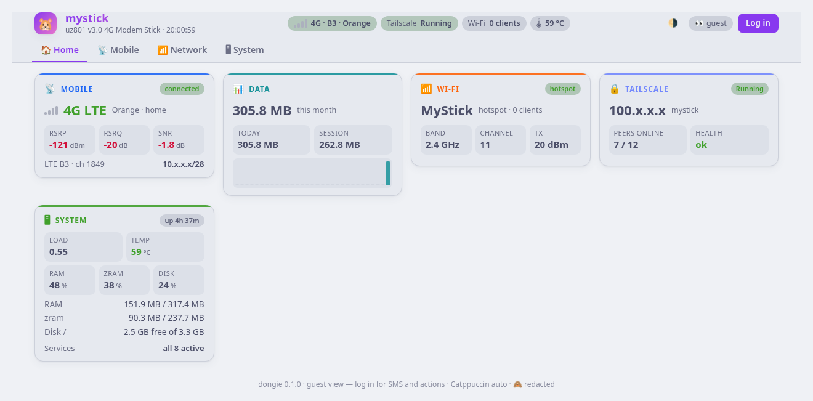
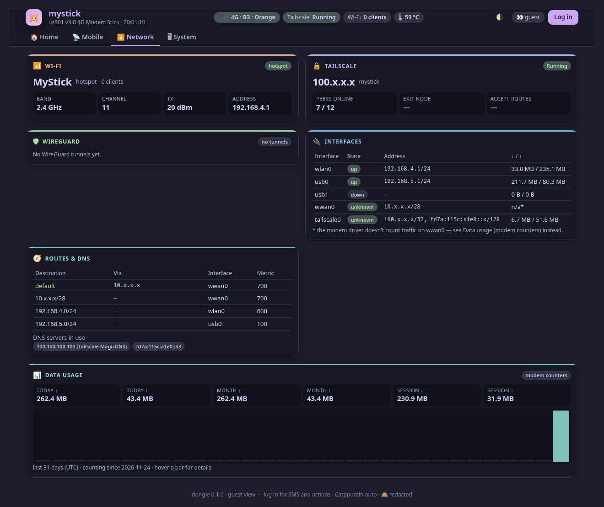

<div align="center">

# 🐹 dongie-rs

**Web dashboard + API for OpenStick 4G USB dongles**

[](LICENSE)
[](docs/install.md)
[](docs/install.md)
[](docs/hardware.md)
[](flake.nix)
[](https://claude.com/claude-code)

</div>

dongie shows what a cheap Qualcomm MSM8916 LTE stick running Debian is doing, lets you
read and send **SMS**, and manages its **Wi-Fi** and **WireGuard** — in a browser or over a
small JSON API. One static ~2 MB binary using a few MB of RAM, made for a stick with
317 MiB of memory and a 1 GHz CPU.

## Features

- 📡 **Mobile** — 3G/4G, band, RSRP/RSRQ/SNR with 24 h charts, neighbour cells, band histogram, everything ModemManager knows
- 📞 **Wi-Fi calling** — answer and make phone calls **in the browser** (WebRTC, HD voice) via **dongie-ims** (separate GPL-3.0 service)
- 💬 **SMS** — conversations, send with delivery reports, RAM-only, SIM kept empty
- 📶 **Wi-Fi** — hotspot or client mode, settings, scan & join, channel usage
- 🛡 **WireGuard & Tailscale** — tunnels via NetworkManager, peers, routes, DNS, connection test
- 📊 **Data usage** — from the modem's own counters, daily / monthly
- 🖥 **System** — RAM, zram, disk, temperatures, **flash write rate**, services, LEDs
- 🔐 **Guest view + admin login**, argon2id, CSRF guard, only reachable over Tailscale
- 🎨 Catppuccin Latte/Mocha, works on phones

→ Full list per tab: [docs/features.md](docs/features.md)

| | |
|---|---|
|  |  |

→ All tabs, light + dark + phone: [docs/screenshots.md](docs/screenshots.md)

## Quick start

```bash
nix develop
cargo build --release --target aarch64-unknown-linux-musl

mkdir /tmp/dongie-install && cp deploy/* target/aarch64-unknown-linux-musl/release/dongie /tmp/dongie-install/
scp -r /tmp/dongie-install user@mystick:/tmp/ && ssh user@mystick 'sudo bash /tmp/dongie-install/install.sh'
ssh -t user@mystick 'sudo dongie user add admin'      # then open http://<tailscale-ip>:8040
```

Set `web_listen` / `api_listen` in `/etc/dongie/config.toml` to your stick's Tailscale IP.
Details: [docs/install.md](docs/install.md)

## API in one line

```bash
curl -s -X POST http://mystick:8041/api/messages -H 'Content-Type: application/json' -d '{"to":"+34600000000","text":"Hola"}'
```

Port **8041** is the open API (status, history, SMS), **8040** the web UI. → [docs/api.md](docs/api.md)

## Docs

| | |
|---|---|
| [Features](docs/features.md) | every tab, guest vs. admin |
| [How it works](docs/architecture.md) | collector, D-Bus SMS, NetworkManager |
| [Security model](docs/security.md) | exposure, accounts, sudoers/polkit, what's deliberately left out |
| [Build & install](docs/install.md) | Nix toolchain, `install.sh`, users |
| [Configuration](docs/configuration.md) | all `config.toml` keys |
| [API](docs/api.md) | endpoints + examples |
| [Helper scripts](docs/contrib.md) | `lte-status`, `fix-attach-apn`, `dongie-leds` |
| [Hardware notes](docs/hardware.md) | what the UZ801 can and can't do |
| [Development](docs/development.md) | layout, tests, UI workflow |

## License

[EUPL-1.2](LICENSE) · third-party components (all permissive): [THIRD-PARTY.md](THIRD-PARTY.md)
