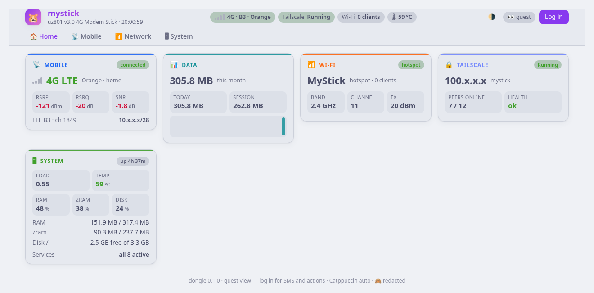
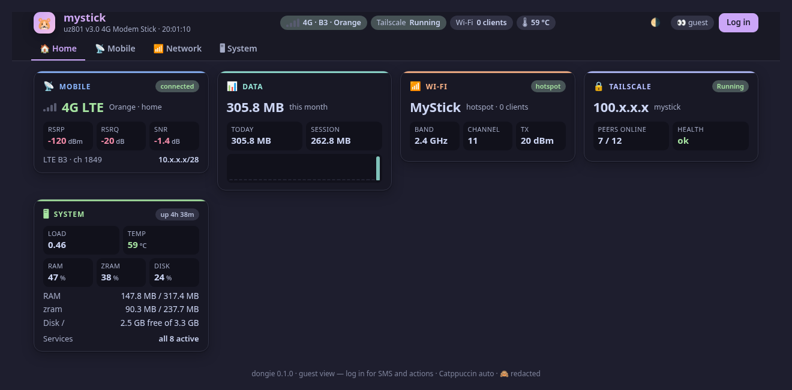
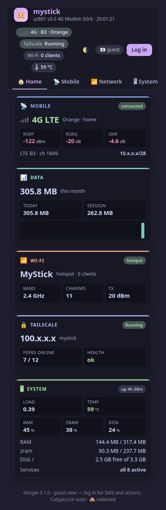
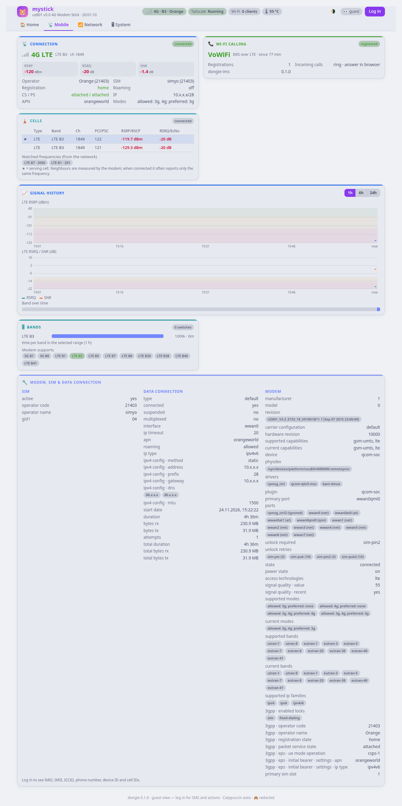
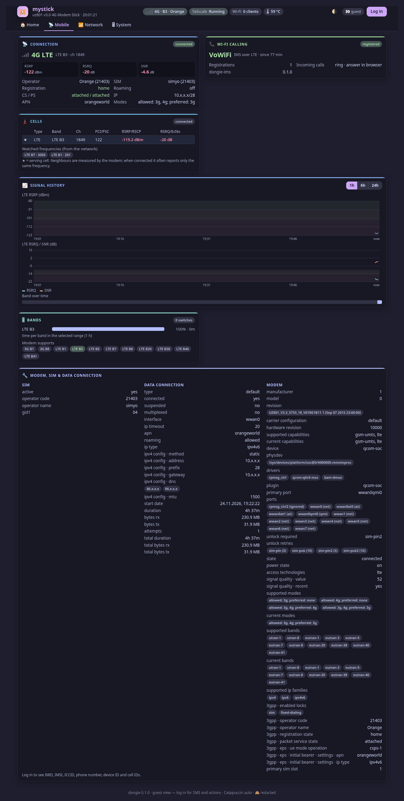
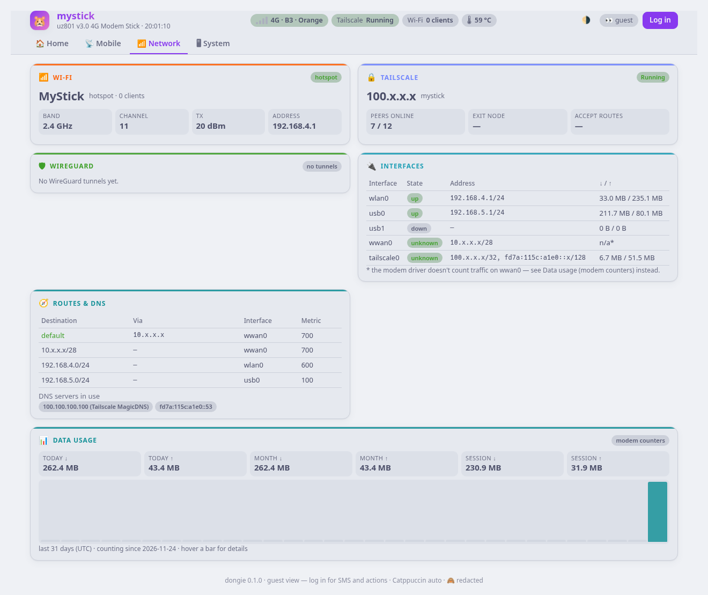
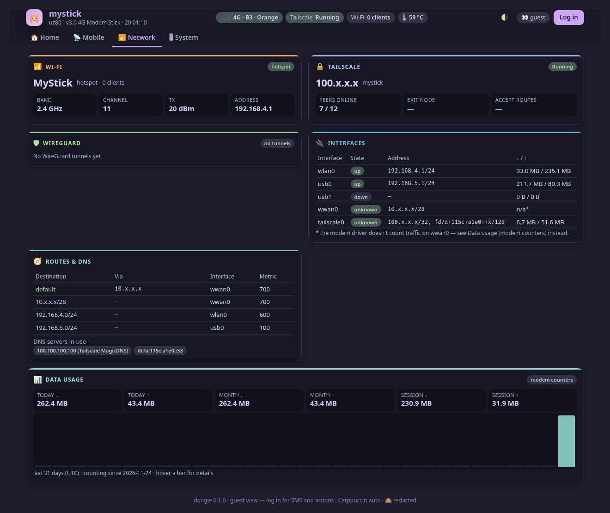
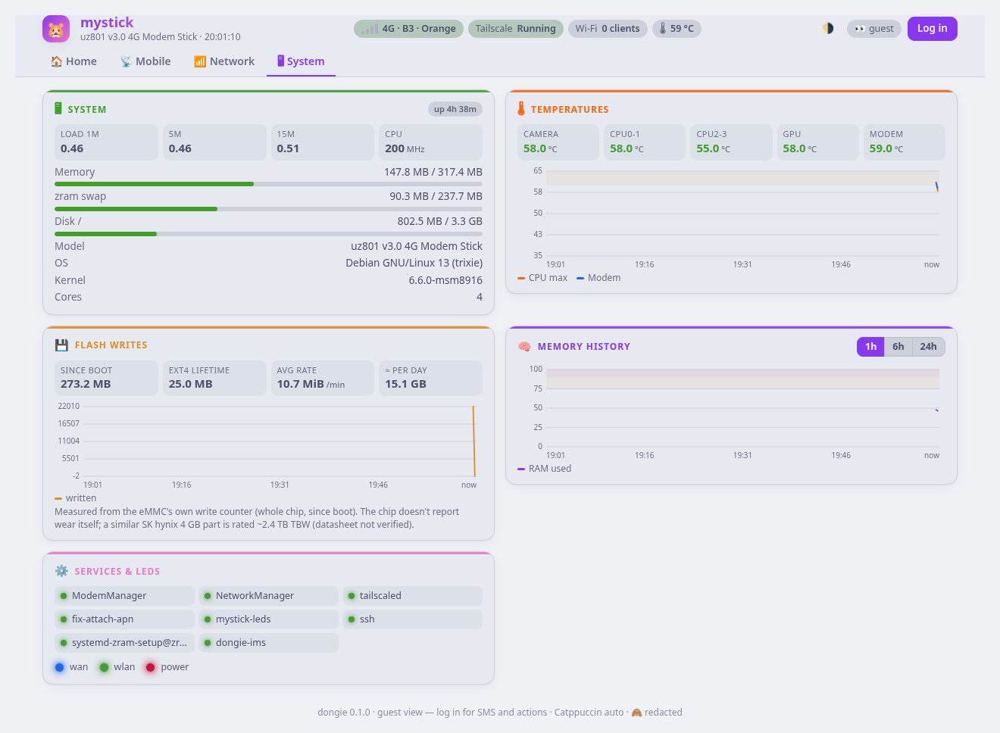
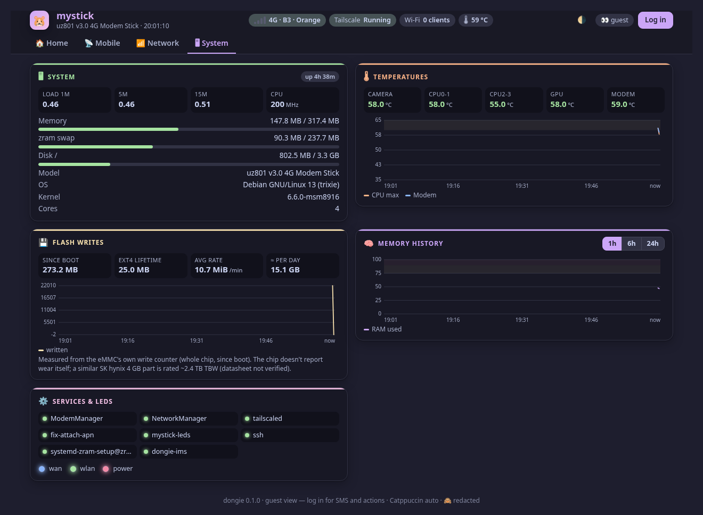

# Screenshots

Taken on a real stick in **guest view** and with **`?redact`**: opening
`http://<stick>:8040/?redact` masks IP addresses (except `192.168.x` and Tailscale's fixed
DNS addresses), shows the host name / MagicDNS name / SSID as `mystick` / `MyStick` and
replaces the tailnet peer counts with placeholders. It only changes what
the page displays; the server is unaffected. The footer shows "🙈 redacted" in that mode.
Admin-only data (IMEI, IMSI, ICCID, phone numbers, cell IDs, SMS, call log, hotspot clients)
never reaches a guest in the first place.

Light = Catppuccin Latte, dark = Catppuccin Mocha (follows the system theme, 🌗 toggles).

## Home

| Latte | Mocha |
|---|---|
|  |  |

On a phone (390 px wide):

## Mobile

Connection, Wi-Fi calling (dongie-ims), cells, signal history, bands, everything ModemManager
reports. The history charts were almost empty when these were taken, because dongie had just
been restarted and keeps its history in RAM only.

| Latte | Mocha |
|---|---|
|  |  |

## Network

| Latte | Mocha |
|---|---|
|  |  |

## System

⚠ **The flash write rate shown here (≈ 7–10 MiB/min, "≈ 9–15 GB/day") is not normal
operation.** The 1 h window includes several binary deploys and SSH sessions from the
development session. Measured at idle right afterwards from `/proc/diskstats`
(45 s settle, 120 s window): **16 KiB in 120 s ≈ 8 KiB/min ≈ 11.5 MB/day**.

| Latte | Mocha |
|---|---|
|  |  |

---
[← back to README](../README.md) · [docs index](README.md)
